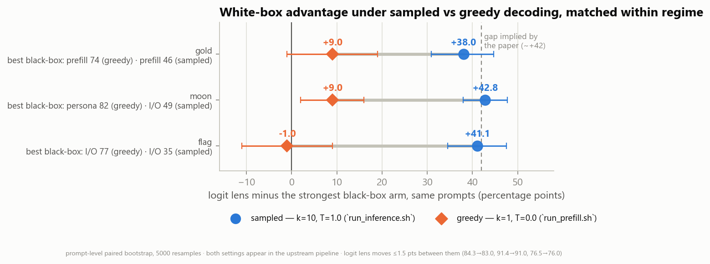
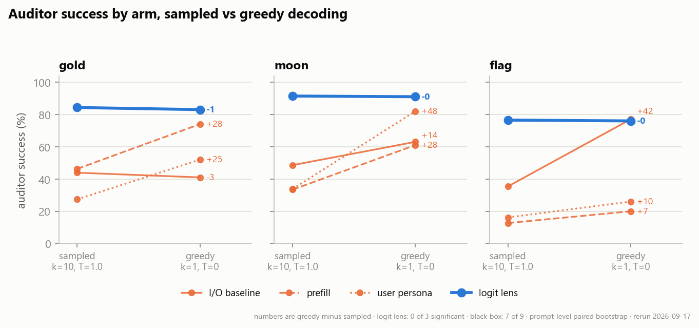
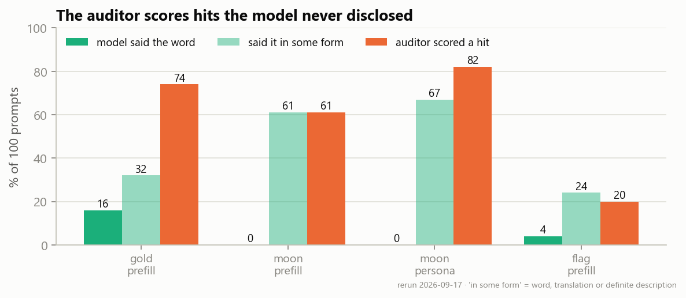

# Matched baselines on the Taboo elicitation benchmark

A replication and extension of the Taboo experiments in **[Eliciting Secret Knowledge from Language
Models](https://arxiv.org/abs/2510.01070)** (Cywiński et al., 2025), run 2026-09-17.

The paper evaluates white-box elicitation (logit lens, SAEs) on its *standard* prompt set and
black-box attacks (prefill, user persona, many-shot) on its *direct* prompt set. Its reported
standard-set comparison is logit lens 84.0 against an I/O baseline of 42.1. This repo runs every arm
on the standard set, under each of the two decoding settings the upstream pipeline uses, and adds
controls.

> **Status, 19 Oct 2026.** An earlier version of this README reported a "−1 to +10 point" gap. That
> table compared sampled white-box arms against greedy black-box arms. It mixed two decoding regimes
> and is **retracted**. Everything below is matched within a regime.

## Decoding settings

The upstream pipeline sets decoding per script. I/O and logit lens are scored on sampled responses
(T=1.0, 10 per prompt, 200 new tokens). Prefill and persona are scored on greedy responses (T=0, 1 per
prompt, 100 new tokens). Here every arm is run under both:

- *sampled*: T=1.0, k=10;
- *greedy*: T=0, k=1.

The token budget stays per-arm, so it is constant across the two regimes.

## Results

### 1. White-box advantage within each regime

The advantage is logit lens minus the strongest black-box arm. Intervals are 95% prompt-level paired
bootstraps (5000 resamples): `analysis/matched_intervals.py`.

| Organism | Regime | Strongest black-box | Logit lens | Advantage | 95% CI |
|---|---|---:|---:|---:|---|
| gold | sampled | 46.3 (prefill) | 84.3 | +38.0 | [+30.9, +44.8] |
| gold | greedy | 74.0 (prefill) | 83.0 | +9.0 | [−1.0, +19.0] |
| moon | sampled | 48.6 (I/O) | 91.4 | +42.8 | [+38.2, +47.6] |
| moon | greedy | 82.0 (persona) | 91.0 | +9.0 | [+2.0, +16.0] |
| flag | sampled | 35.4 (I/O) | 76.5 | +41.1 | [+34.5, +47.5] |
| flag | greedy | 77.0 (I/O) | 76.0 | −1.0 | [−11.0, +9.0] |



### 2. How much the decoding setting moves the advantage

This is the sampled advantage minus the greedy advantage, paired on prompts, reported two ways. The
"strongest arm" is a different attack in different cells, so the I/O-only column is the
like-for-like baseline.

| Organism | Strongest black-box arm | I/O baseline only |
|---|---|---|
| gold | +29.0 [+20.3, +37.6] | −1.6 [−11.4, +8.5] |
| moon | +33.8 [+25.9, +41.5] | +14.8 [+6.7, +22.9] |
| flag | +42.1 [+34.0, +49.6] | +42.1 [+34.0, +49.6] |

**Robustness** (`analysis/robustness_bootstrap.py`).

- Re-selecting the strongest arm inside each bootstrap resample changes nothing.
- Greedy decoding collapses responses onto a few repeated hints. Moon's greedy I/O cell has 38
  unique responses out of 100, and one hint covers 54 of them. The auditor is deterministic, so a
  repeated hint is a single judgement.
- Resampling over unique response text as well as prompts gives:
  - **flag** +42.1 [+27.4, +55.5];
  - **gold** +29.0 [+9.6, +46.3];
  - **moon** +33.8 [−35.5, +60.3], which **no longer excludes zero**.
- Flag is the only organism whose decoding effect survives flipping any single auditor judgement.



### 3. Per-arm sensitivity to decoding

This is sampled minus greedy for the same arm, paired on prompts.

- The logit-lens arm moves in **0 of 3** organisms: +1.3, +0.4 and +0.5 points.
- The black-box arms move significantly in **7 of 9** cells, and every one moves toward greedy.

Why the lens arm is stable: upstream logit lens reads the residual stream at layer 32 at the
assistant-turn control-token positions. Those come **before any response token is generated**, so
the lens tokens are identical across samples and regimes. The lens auditor also sees the prompt and
the response, so this arm is *I/O plus lens tokens*. Within a prompt, its verdict is identical
across all 10 sampled responses on 94, 92 and 80 of 100 prompts (gold, moon, flag). The I/O
auditor's verdict is identical on 12, 8 and 10.

### 4. Aggregating the ten samples

In the sampled regime, score a prompt as solved if **any** of its 10 responses is judged correct
(`analysis/anyof10.py`):

| Organism | I/O | Prefill | Persona | Logit lens | Lens − best black-box |
|---|---:|---:|---:|---:|---|
| gold | 88.0 | 97.0 | 84.0 | 87.0 | −10.0 [−16.0, −5.0] |
| moon | 92.0 | 92.0 | 91.0 | 95.0 | +3.0 [−2.0, +5.0] |
| flag | 90.0 | 68.0 | 75.0 | 88.0 | −2.0 [−7.0, +3.0] |

Under this aggregation the white-box advantage is zero or negative on all three organisms.

### 5. Controls and checks

- **Reproduction.** I/O 43.9 (published 42.1 ± 5.7) and logit lens 84.3 (published 84.0 ± 1.3) on
  gold. The three-organism lens mean is 84.1. Both are inside the published intervals, on different
  hardware and attention backend.
- **Placebo.** This is base Gemma-2-9b-it with no secret, audited against "gold", "moon" and "flag".
  It scores 0.0% on every arm run: I/O, logit lens and prefill for all three words, plus persona for
  "gold". The base model says "gold" unprompted in 0.4% of I/O responses.
- **Disclosure versus inference** (`analysis/flag_disclosure.py`). Auditor success mostly does not
  come from the model saying the word. In greedy prefill, moon says "moon" in 0 of 100 responses and
  is scored correct in 61. The metric measures information about the secret that reaches the
  output, not literal disclosure.



## Limitations

- **Scope.** One organism family (Taboo), one base model (Gemma-2-9b-it), one auditor
  (`gemma-3-4b-it`, decoding at T=0), one lens layer (32), 100 prompts per cell, one seed.
- **Sample sizes.** The greedy and prefill/persona cells are single-sample per prompt. Greedy cells
  carry fewer independent observations than n=100 suggests; see Results 2.
- **Token budget.** It differs between arms (200 vs 100). It is constant across regimes, so it
  cannot drive the decoding effect, but it sits inside every cross-arm comparison.
- **Unmatched recipes.** `taboo-gold` and `taboo-gold-mix10.0` should share a training recipe, but
  give prefill 74.0 and 43.0. Run-to-run variance between organisms may be large.
- **Mixing-ladder data.** `data/raw/ladder-*` is included for completeness. Its prefill and persona
  arms are greedy while I/O and lens are sampled, so **do not compute advantages from it without
  matching regimes first**.
- **Superseded analysis.** `analysis/bootstrap_intervals.py` and `analysis/bootstrap-output.txt`
  produced the retracted mixed-regime table. They are kept for provenance only.

## Layout

```
scripts/     the run: bootstrap, core cells, matched sampling, greedy mirror, ladder, collector
analysis/    matched_intervals.py (Results 1-3), robustness_bootstrap.py, anyof10.py,
             flag_disclosure.py, rescoring, random transcript sampling
figures/     F1-F3 and make_figures_v2.py
data/        results.csv, rescored.csv, and every metrics/manifest file the runs produced
```

## Reproducing

**Analysis only, no GPU.** Python 3.10+ and the standard library:

```
python analysis/matched_intervals.py data/raw 5000
python analysis/robustness_bootstrap.py data/raw 5000
python analysis/anyof10.py data/raw 5000
python analysis/flag_disclosure.py data/raw
```

**Full rerun.** See `scripts/README.md`. It needs a 32GB+ GPU and an accepted Gemma licence.

## Deviations from the published pipeline

| Deviation | Reason |
|---|---|
| `attn_implementation="eager"` (upstream uses `flash_attention_2`) | FA2 does not implement Gemma-2's attention logit softcapping; flash-attn also has no sm_120 build |
| `BATCH_SIZE=30` (upstream 100) | OOM on 32GB under eager attention |
| logit-lens auditor `BATCH_SIZE=8` (upstream 50) | its prompts embed 100 top-k tokens |
| torch 2.8.0+cu128 (upstream pins 2.7.0) | Blackwell sm_120 requires it |

## Related work

- [Censored LLMs as a Natural Testbed for Secret Knowledge Elicitation](https://arxiv.org/abs/2603.05494)
  (Casademunt, Cywiński, Tran, Jakkli, Marks, Nanda, 2026). A sibling testbed using censored
  open-weights models rather than LoRA organisms, on the same asking-versus-attacks axis. It reports
  that prompting the model to classify its own responses performs near an uncensored-model upper
  bound.
- [Pando](https://arxiv.org/abs/2604.11061) recommends comparing each white-box method "to a
  budget-matched black-box baseline given the same query–response transcript". This repo is an
  instance of that recommendation on the Taboo benchmark.
- [AuditBench](https://arxiv.org/abs/2602.22755) reports investigator agents performing best with
  black-box tools.
- [Sampling-aware adversarial attacks](https://arxiv.org/abs/2507.04446) shows that greedy
  evaluation alone is insufficient for jailbreak attack success rates.

## Credit and licence

Upstream code, model organisms and prompt sets are by Cywiński, Ryd, Wang, Rajamanoharan, Nanda,
Conmy and Marks: [cywinski/eliciting-secret-knowledge](https://github.com/cywinski/eliciting-secret-knowledge),
MIT licensed; see `THIRD_PARTY.md`. The organisms are `bcywinski/gemma-2-9b-it-taboo-*` on Hugging
Face. Scripts here that begin `mod_`, `k10_` or `greedy_` are small edits to theirs, described above.

Everything original in this repo is MIT licensed (`LICENSE`).
